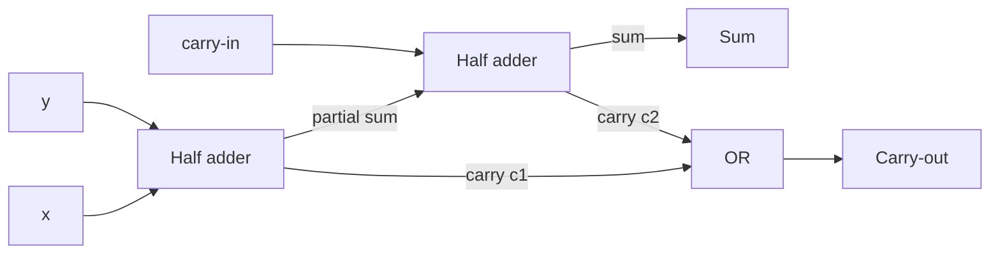

---
tags:
  - cs245
  - logic
  - uwaterloo
course: CS 245
term: Fall 2026
---

# CS 245 — Logic and Computation — Complete Notes

*UWaterloo, instructor Lila Kari. All propositional-logic lectures in one file. Math is written in plain Unicode so it reads in any viewer (Obsidian, terminal, GitHub). A per-chapter **Glossary** is at the end.*

> [!warning] Topics 6–7 are reconstructed
> Those two lecture transcripts came through auto-transcription badly garbled, with no slides. Both were reconstructed from the clear fragments + standard course material — verify against the official slides when posted.

## 📖 Index

1. **[[#Topic 1 — Introduction to Logic|Topic 1 — Introduction to Logic]]** — logic & arguments, connectives & truth tables, named argument forms, ambiguity
2. **[[#Topic 2 — Propositional Language ℒᵖ: Syntax|Topic 2 — Propositional Language ℒᵖ: Syntax]]** — the language ℒᵖ, formulas, induction & structural induction, Unique Readability, precedence & scope
3. **[[#Topic 3 — Propositional Language: Semantics|Topic 3 — Semantics]]** — truth valuations, satisfiability, tautologies, tautological consequence ⊨, proving validity, Replaceability & Duality
4. **[[#Topic 4 — Propositional Calculus: Essential Laws & Normal Forms|Topic 4 — Essential Laws & Normal Forms]]** — the essential laws, simplification, DNF/CNF, converting via laws or truth tables
5. **[[#Topic 5 — Tutorial: DNF & CNF Both Ways (+ Gray Codes & Karnaugh Maps)|Topic 5 — DNF & CNF Tutorial]]** — a worked recitation: CNF three ways, the one-literal merge, Gray codes & Karnaugh maps
6. **[[#Topic 6 — Adequate Sets of Connectives, Boolean Algebra & Digital Circuits|Topic 6 — Adequacy, Boolean Algebra & Circuits]]** — counting connectives, adequate sets, NAND/NOR, Boolean algebra, logic gates
7. **[[#Topic 7 — Combinational Circuit Design, Adders & Minimization|Topic 7 — Combinational Circuits & Adders]]** — circuit drawing, minimization, majority vote, parity/XOR, binary arithmetic, half/full adders, simplifying code
8. **[[#Glossary|Glossary]]** — key terms, grouped by chapter

### How to read these notes

`[!note]`/`[!abstract]` = definitions & theorems · **⚠️ `[!warning]`** = edge cases / exam traps · **💡 `[!tip]`** = instructor intuition from lecture · **✅ `[!success]`** = the key rule to remember · **`[!example]`** = worked problems & puzzles · **`[!summary]`** = per-topic learning objectives. Math symbols are written directly as Unicode (¬ ∧ ∨ → ↔ ⊨ ≡ ∑ …) so they read in any viewer.

**Source materials:** slide decks `CS245-2Mode-LogicNN-…-pedagogical*.pdf`; lecture transcripts. Topics 1–2 were slide-only; Topics 3–7 integrate transcripts.

> [!tip] Navigation
> In Obsidian, use the **Outline** panel (or the heading list) to jump between topics; in a terminal, search (`/`) for "# Topic N" or "## Glossary".

---

# Topic 1 — Introduction to Logic

> [!abstract] Goal
> Understand what logic studies (the **form** of arguments), the notion of a **valid** argument, the five **logical connectives** and their truth tables, and how to translate English into precise logic.

## 1.1 What is logic?

- **Logic** is the **Science of Reasoning** (etymology: *logikos*, Greek, "pertaining to reasoning").
- Working definitions: the science of reasoning, proof, thinking, or inference; and most usefully for us, *the analysis and appraisal of arguments*.
- We all "do logic" whenever we clarify reasoning and separate **good reasoning from bad**.

## 1.2 A little history

- **Aristotle** (384–322 B.C.) wrote the earliest known *formal* study of logic — the first comprehensive system for codifying and evaluating arguments. Student of **Plato**, tutor of **Alexander the Great**.
- A **syllogism** is a logical argument in which a conclusion is inferred from two or more premises of a specific form:

> All humans are mortal.
> Socrates is human.
> ∴ Socrates is mortal.

> [!tip] Core Aristotelian insight
> The correctness of an argument depends on its **form (structure), not its content**. The same *form* can be filled with any subject matter.

- **Valid form:** "All x are y; B is an x; therefore B is a y."
- **Invalid form** — spotting it needs a counterexample: "All x are y; some y are z; ∴ some x are z." Counterexample: *all bunnies are mammals; some mammals are fierce predators; ∴ some bunnies are fierce predators.* (False conclusion from true premises → the form is invalid.)

> [!info] Why study logic?
> It sharpens general analytical thinking and is **fundamental to Computer Science**. As Turing (1947) predicted, the languages we use to communicate with computing machines "form a sort of symbolic logic."

## 1.3 Applications of logic to computer science

- **Logic gates** underpin all electronic computers; logic is used to **minimize** circuit components.
- **Proof assistants** (Lean, Rocq, Isabelle) produce machine-checked proofs — e.g. the **Flyspeck** project (Kepler conjecture) and a proposed Lean proof for Navier–Stokes.
- **AI for theorem proving:** AlphaProof searches for formal proofs; AlphaGeometry combines learned guidance with symbolic deduction.
- **Databases:** first-order logic underlies relational calculus and, in part, **SQL**.
- **Programming:** program specification & formal verification; **PROLOG** (logic programming); **SAT/SMT solvers** (e.g. Z3); even **DNA computing** of Boolean gates.

## 1.4 Propositional logic — the basics

- **Propositional logic** studies logical relationships between **propositions** (true/false statements).
- A **proposition** is a *declarative statement that is either true or false*. Meaningless statements, commands, and questions are **not** propositions.
- Proposition symbols p, q, r; two **propositional constants**: **true** (1) and **false** (0).
- **Atomic** propositions cannot be subdivided; **compound** propositions combine atomic ones using **logical connectives** (*and, or, not, if-then*).

**Which are propositions?** "Waterloo is the capital of Ontario" (proposition, false); "2+3=5" (true); "x+2=11" (not a proposition — depends on x); "Answer this question" / "What time is it?" (commands/questions — not propositions); "x+y=y+x for every real x,y" (proposition, true).

### Valid vs. invalid arguments

- A **(logical) argument** is a set of statements — one or more **premises** and a **conclusion** — connected by "therefore".
- **Definition (Valid).** An argument is **valid** (correct, sound) if *whenever all the premises are true, the conclusion is also true*.

> [!warning] Crucial notes about validity
> - A valid argument can still have a **false conclusion** — this happens exactly when one of the premises is false.
> - Validity *only* guarantees: **if all premises are true, then the conclusion is true**.
> - A false conclusion does **not** prove an argument invalid.
> - Logic studies **forms** of reasoning; the content can be anything (water purity, cooking, physics, ethics…).

## 1.5 Logical connectives & truth tables

Natural language is ambiguous, so we introduce precise mathematical symbols. **Convention:** stating a proposition in English asserts it is true ("p" means "p holds").

| p | q | ¬ p | p ∧ q | p ∨ q | p → q |
|---|---|---|---|---|---|
| 0 | 0 | 1 | 0 | 0 | 1 |
| 0 | 1 | 1 | 0 | 1 | 1 |
| 1 | 0 | 0 | 0 | 1 | 0 |
| 1 | 1 | 0 | 1 | 1 | 1 |

- **Negation** ¬ p: true when p is false. (The only **unary** connective.)
- **Conjunction** p ∧ q ("and"): true only when both are true. Not every English "and" is a conjunction ("Jack and Jill are cousins" is not).
- **Disjunction** p ∨ q (**inclusive** or): true when at least one holds. English "or" can be exclusive ("soup or salad") — translate p ∨ q as "p or q, or both".
- **Implication** p → q: false **only** when p is true and q is false; p = antecedent, q = consequent. When p is false, p → q is **vacuously true** ("If the sun rises in the West, I'll eat my hat").

> [!note] Equivalent ways to express p → q
> "if p then q"; "p only if q"; "p is sufficient for q"; "q if p"; "q whenever p"; "q is necessary for p"; "q is implied by p".
> Note: "p **if** q" translates to q → p. The **converse** of p → q is q → p.

- **Equivalence (biconditional)** p ↔ q: true exactly when p and q have the **same** truth value ("p iff q"). It bundles p → q (the "only if" part) with q → p (the "if" part).

| p | q | p ↔ q |
|---|---|---|
| 0 | 0 | 1 |
| 0 | 1 | 0 |
| 1 | 0 | 0 |
| 1 | 1 | 1 |

- **Symmetry:** ∧, ∨, ↔ are symmetric (order doesn't matter). → is **not** symmetric: p → q and q → p can differ. Beware English that says "equivalent" but means implication.

## 1.6 Some important named argument forms

| Name | Form | Example |
|---|---|---|
| **Modus ponens** | p → q; p ⊢ q | If it rains I get wet; it is raining; ∴ I get wet. |
| **Modus tollens** | p → q; ¬ q ⊢ ¬ p | If I do all my chores I get a puppy; no puppy; ∴ I didn't do all my chores. |
| **Hypothetical syllogism** | p → q; q → r ⊢ p → r | Demand rises → expand; expand → hire; ∴ demand rises → hire. |
| **Disjunctive syllogism** | p ∨ q; ¬ q ⊢ p | Day or night; not night; ∴ day. |

## 1.7 Ambiguity & imprecision

- An **ambiguous** sentence has *more than one distinct meaning* ("David and John from Toronto…" — who is from Toronto?). Resolve by querying the author or using context.
- An **imprecise / vague** sentence has one meaning but no clear-cut true/false boundary ("John is tall" → "John is over 2 m tall"). Resolve by introducing **quantitative measures**.

> [!example] A riddle
> Suppose both are true: (1) "I love Betty **or** I love Jane." (2) "**If** I love Betty **then** I love Jane." Does it follow that I love Jane? **Yes** — if I love Betty, (2) forces Jane; if not Betty, (1) forces Jane. Does it follow that I love Betty? **No.**

---

# Topic 2 — Propositional Language ℒᵖ: Syntax

> [!abstract] Goal
> Define the formal language ℒᵖ and its set of **formulas**, parse them, and prove properties of *all* formulas using **structural induction** — culminating in the **Unique Readability Theorem**.

**Syntax** = the rules for *constructing* formulas (the logic analogue of a programming language's grammar). A "syntax error" is an expression that is **not** in Form(ℒᵖ).

## 2.1 Symbols and expressions of ℒᵖ

Strings in ℒᵖ use three classes of symbols:

- **Proposition symbols:** p, q, r, … (unboundedly many, with or without subscripts).
- **Connective symbols:** ¬, ∧, ∨, →, ↔.
- **Punctuation:** left and right parentheses ( , ).

**Expressions** are finite strings of allowed symbols:

- **Length** = number of symbol occurrences (e.g. ¬(p ∨ q) has length 6).
- **Empty expression** ε (length 0).
- Two expressions are **equal** iff same length and same symbols in the same order; scanning goes left→right.
- **Concatenation** UV; note ε U = U ε = U.
- If U = W₁ V W₂ then V is a **segment** of U; a **prefix** (initial segment) if W₁ = ε, a **suffix** (terminal segment) if W₂ = ε; **proper** if not equal to U.

## 2.2 The set of formulas Form(ℒᵖ)

> [!note] Definition (recursive)
> Atom(ℒᵖ) = expressions consisting of a single proposition symbol.
> **BASE:** every atom is a formula.
> **RECURSION:** if A and B are formulas, then so are (1) (¬ A), (2) (A ∧ B), (3) (A ∨ B), (4) (A → B), (5) (A ↔ B).
> **RESTRICTION:** nothing else is a formula.

- Rules (1)–(5) are the **formation rules**. Fully parenthesized expressions guarantee unambiguous parsing.
- ((p ∧ q) → r) is a formula but not an atom; p∧∧∧(((r→ is an expression but **not** a formula.

## 2.3 Generating & parsing formulas

Building ((p ∨ q) → ((¬ p) ↔ (q ∧ r))): apply BASE to p, q, r, then rule (1) for (¬ p), rules (3)/(2) for (p ∨ q) and (q ∧ r), rule (5), and finally rule (4).

A **parse tree** analyzes a formula's structure; its **root** is the **main connective**. The Unique Readability Theorem guarantees this decomposition is well-defined.

## 2.4 Mathematical induction (review)

> [!important] Principle of Mathematical Induction
> If (1) 0 has property P, and (2) whenever a natural number has P, so does the next one, then **every** natural number has P. (Like toppling dominoes.)

**Template:** a **Base Case** proving P(0), and an **Inductive Step** proving P(k) ⇒ P(k+1) (assuming P(k), the **Inductive Hypothesis**). Use a fixed k (arbitrary but fixed) distinct from the universally-quantified n.

**Example.** Show ∑ₓ₌₀ⁿ x = (n(n+1))/(2):

∑ₓ₌₀ᵏ⁺¹ x = (∑ₓ₌₀ᵏ x) + (k+1) =⟨I.H.⟩ (k(k+1))/(2) + (k+1) = ((k+1)(k+2))/(2)

**Simple vs. Strong (course-of-values) induction:** *no real difference*. Strong induction assumes P(m) for **all** m ≤ k; define Q(k) ≡ "P(m) holds for all m ≤ k" and simple induction on Q recovers it.

**Cautionary tale.** The "*all horses are the same colour*" proof breaks because the two overlapping subsets (first k and last k) need not overlap when k = 1.

**Valid induction example — Tiling checkerboards:** every 2ⁿ × 2ⁿ board with one square removed can be tiled by L-shaped **right triominoes**. Base n = 1; inductive step splits the 2ᵏ⁺¹ × 2ᵏ⁺¹ board into four 2ᵏ × 2ᵏ quadrants, places one triomino at the shared center, then applies the I.H. to each quadrant.

## 2.5 Recursively defined sets & structural induction

A recursive set definition has **BASE** (core objects), **RECURSION** (rules building new objects from old), **RESTRICTION** (nothing else). Both ℕ (base 0, rule "add 1") and Form(ℒᵖ) are recursively defined.

> [!important] Structural Induction
> To prove every object of a recursively defined set S has property R:
> **(I) Base case(s):** show each BASE object satisfies R.
> **(II) Inductive step:** for **each** recursion rule, show that if it is applied to objects already satisfying R, the new object also satisfies R.

**Applied to Form(ℒᵖ):** show every atom has R, and that R is preserved by each of the five formation rules (¬ A), (A ∧ B), (A ∨ B), (A → B), (A ↔ B).

**Lemma 1.** *Every formula has an equal number of left and right parentheses.* **Proof by structural induction.** Base: an atom has 0 of each. Step (e.g. ¬): let ℓ(A), r(A) count "(" and ")". Then ℓ((¬ B)) = 1 + ℓ(B) =⟨I.H.⟩ 1 + r(B) = r((¬ B)). The binary cases are analogous.

## 2.6 The Unique Readability Theorem

> [!abstract] Unique Readability Theorem
> Every formula in Form(ℒᵖ) is of **exactly one** of six forms — an atom, (¬ B), (B ∧ C), (B ∨ C), (B → C), or (B ↔ C) — and in each case in **exactly one way**.

**Supporting claims:**

- **(a)** The first symbol of a formula is "(" or a proposition symbol.
- **(b)** Every formula has equally many "(" and ")" (Lemma 1).
- **(c)** Every non-empty proper **prefix** of a formula has *more* "(" than ")" (so it cannot itself be a formula).

**Proof sketch.** Assume a formula F has two decompositions. Cases where the two main connectives (or an atom vs. a compound) differ lead to contradictions via claims (a)–(c). In the matching case, if the sub-parts B, B' had different lengths, the shorter would be a proper prefix of the other and thus (by (c)) have unequal parentheses — contradicting (b). Hence the decomposition is unique. ∎

**Consequences — the six kinds of formula:** atom, **negation** (¬ A), **conjunction** (A ∧ B) (conjuncts A, B), **disjunction** (A ∨ B) (disjuncts), **implication** (A → B) (antecedent/consequent), **equivalence** (A ↔ B) — each formula is exactly one kind.

**Parsing algorithm** (find subformulas): after the first "(", start a counter = (#left − #right) parentheses; when it returns to 0 the first subformula has ended, exposing the main connective.

## 2.7 Precedence rules & scope

Human logicians drop parentheses using precedence (highest→lowest):

¬ over ∧ over ∨ over → over ↔

- ¬ p ∨ q means ((¬ p) ∨ q); p ∧ q ∨ r means ((p ∧ q) ∨ r); p → q ∨ r means (p → (q ∨ r)); p ↔ p → q means (p ↔ (p → q)).
- **Scope:** in (¬ A), A is the scope of the ¬. In (A ∧ B), A is the **left scope** and B the **right scope** (similarly for the other binary connectives).

> [!summary] Learning objectives (Topic 2)
> Know ℒᵖ, expressions, Atom and Form; generate/parse formulas (parse trees); mathematical induction; recursive sets; **structural induction**; the Unique Readability Theorem (statement, proof, consequences); precedence rules; scope of a connective.

---

# Topic 3 — Propositional Language: Semantics

> [!abstract] Goal
> Give formulas **meaning** via truth valuations; define satisfiability, tautologies, and **tautological consequence** ⊨; and prove arguments valid (truth tables or proof by contradiction) or invalid (counterexample).

**Semantics** = *meaning*. Atoms express propositions (true/false); connectives take their intended meanings; the truth value of a compound formula is derived from the truth values of its atoms plus the connective definitions.

**Example.** "If you take a class in computers and you do not understand recursion, you will not pass." With p = take class, q = understand recursion, r = pass, this is (p ∧ ¬ q) → ¬ r. To find its meaning we first **parse**, then evaluate.

## 3.1 Truth valuations & truth tables

> [!note] Definition — truth valuation
> A **truth valuation** is a function t : Atom(ℒᵖ) → {0,1}. For a formula A, write Aᵗ for its value under t. A **truth table** lists a formula's values under all valuations; **one row = one truth valuation**.

**Recursive value of a formula under t:**

(¬ A)ᵗ = 1 if Aᵗ = 0; 0 if Aᵗ = 1 (A ∧ B)ᵗ = 1 if Aᵗ = Bᵗ = 1; 0 if else

(A ∨ B)ᵗ = 1 if Aᵗ = 1 or Bᵗ = 1; 0 if else (A → B)ᵗ = 1 if Aᵗ = 0 or Bᵗ = 1; 0 if else

(A ↔ B)ᵗ = 1 if Aᵗ = Bᵗ; 0 if else

A formula's value can differ from one valuation to another. **Truth-table size:** with n proposition symbols and m connectives, there are 2ⁿ **rows** and ≤ n + m **columns**.

> [!example] Knights & knaves puzzle
> Twins Jenny & Susan; one always lies (knave), one always tells the truth (knight). Ask either one: *"Is Susan a knave?"* The answer is **"yes" iff you are talking to Jenny.** (Verify by truth table over the two identity/type cases.)

## 3.2 Satisfiability, tautologies, contradictions

- t **satisfies** A iff Aᵗ = 1; A is **satisfiable** iff some valuation satisfies it.
- For a set Σ: Σᵗ = 1 iff **every** formula in Σ is true under t; Σ is **satisfiable** if some t gives Σᵗ = 1, else **unsatisfiable**.
- **Edge case:** the empty set ∅ satisfies ∅ᵗ = 1 for **all** t (vacuously — there is no formula to falsify).

> [!note] Definitions
> - A is a **tautology** iff Aᵗ = 1 for **all** valuations t.
> - A is a **contradiction** iff Aᵗ = 0 for **all** valuations t.
> - A is **contingent** iff it is neither a tautology nor a contradiction.
>
> Note: A is a tautology **iff** ¬ A is a contradiction.

**Three essential laws of thought (Plato):**

| Law | Statement | Formula |
|---|---|---|
| **Identity** | "Whatever is, is." | p = p |
| **Contradiction** | "Nothing can both be and not be." | ¬(p ∧ ¬ p) is a tautology |
| **Excluded middle** *(tertium non datur)* | "Everything must either be, or not be." | p ∨ ¬ p is a tautology |

## 3.3 Tautological consequence ⊨

> [!note] Definition — tautological consequence
> For Σ ⊆ Form(ℒᵖ) and formula A, we say A is a **tautological consequence** of Σ, written Σ ⊨ A, iff for **every** valuation t: Σᵗ = 1 ⇒ Aᵗ = 1.

- ⊨ is **not** a symbol of ℒᵖ; "Σ ⊨ A" is a statement in the **metalanguage** about Σ and A. Write Σ ⊭ A for its negation.
- **Special case ∅ ⊨ A:** since ∅ᵗ = 1 always, this holds iff Aᵗ = 1 always — i.e. A **is a tautology**.

> [!important] Argument validity ⇔ tautological consequence
> For premises Σ = {A₁, …, Aₙ} and conclusion C, the following are **equivalent**:
> - the argument is **valid**;
> - {A₁, …, Aₙ} ⊨ C;
> - (A₁ ∧ … ∧ Aₙ) → C is a **tautology**;
> - (A₁ ∧ … ∧ Aₙ ∧ ¬ C) is a **contradiction**;
> - the set {A₁, …, Aₙ, ¬ C} is **unsatisfiable**.

**Tautological equivalence ≡** (course notation A ⊨⊨ B): means A ⊨ B **and** B ⊨ A — equivalently A ↔ B is a tautology. Equivalent formulas get the same value under every valuation. It is **weaker than equality**: ¬(p ∧ q) ≡ (¬ p ∨ ¬ q) although the two formulas are literally different.

> [!tip] Connective vs. meta-relation
> A → B is a *formula* (can be true or false); A ⊨ B is a *statement* (holds iff A → B is a tautology). Likewise A ↔ B vs. A ≡ B.

## 3.4 Proving validity — method 1: truth tables

To prove Σ ⊨ A, check every valuation satisfying Σ also satisfies A.

**Example.** {p → q, q → r} ⊨ (p → r). The rows where **both** premises hold (marked ←) all have conclusion p → r = 1, so the argument is valid.

| p | q | r | p → q | q → r | A₁ ∧ A₂ | p → r |
|---|---|---|---|---|---|---|
| 0 | 0 | 0 | 1 | 1 | 1 ← | 1 |
| 0 | 0 | 1 | 1 | 1 | 1 ← | 1 |
| 0 | 1 | 0 | 1 | 0 | 0 | 1 |
| 0 | 1 | 1 | 1 | 1 | 1 ← | 1 |
| 1 | 0 | 0 | 0 | 1 | 0 | 0 |
| 1 | 0 | 1 | 0 | 1 | 0 | 1 |
| 1 | 1 | 0 | 1 | 0 | 0 | 0 |
| 1 | 1 | 1 | 1 | 1 | 1 ← | 1 |

**Proving invalidity — a counterexample.** To show Σ ⊭ A, exhibit **one** valuation making all premises true but the conclusion false. E.g. (p → q) ∨ (p → r) ⊭ p → (q ∧ r) via p = 1, q = 1, r = 0.

## 3.5 Proving validity — method 2: proof by contradiction

Truth tables blow up (2ⁿ rows), so we reason directly. **Idea:** to prove Σ ⊨ A, *assume the contrary* — a valuation t with all premises true but Aᵗ = 0 — and derive a contradiction.

**Example.** {A → B, B → C} ⊨ (A → C).
Assume (A → B)ᵗ = 1, (B → C)ᵗ = 1, (A → C)ᵗ = 0. From the last: Aᵗ = 1, Cᵗ = 0. From Aᵗ = 1 and premise 1: Bᵗ = 1. From Bᵗ = 1 and premise 2: Cᵗ = 1 — contradicting Cᵗ = 0. Hence the argument is **valid**. (A **direct proof** is also allowed: start from an arbitrary t with premises true and derive Aᵗ = 1.)

> [!tip] Why proof-by-contradiction works
> A theorem (A₁ ∧ … ∧ Aₙ) → C, i.e. A → C, uses (A → C) ≡ (¬ A ∨ C) ≡ ¬(A ∧ ¬ C). Proving the theorem is a tautology = proving (A ∧ ¬ C) is a **contradiction**. Assume Aᵗ = 1, Cᵗ = 0 and derive some D with Dᵗ = 1 **and** Dᵗ = 0 (impossible).

## 3.6 De Morgan's laws, converse, contrapositive

> [!note] De Morgan's Laws
> ¬(p ∧ q) ≡ (¬ p ∨ ¬ q) ¬(p ∨ q) ≡ (¬ p ∧ ¬ q)
> To negate a conjunction, take the disjunction of the negated conjuncts (and dually). They show how ¬ distributes over ∧ and ∨.

For an implication p → q:

- **Contrapositive** ¬ q → ¬ p — **equivalent** to the original: p → q ≡ ¬ q → ¬ p.
- **Converse** q → p — **not** equivalent in general.

**Biconditional decomposition:** p ↔ q ≡ (p → q) ∧ (q → p). To prove A ↔ B, prove both directions: A → B ("only if") and B → A ("if").

## 3.7 Replaceability, Duality, and other logics

> [!abstract] Theorem — Replaceability of tautologically equivalent formulas
> If a formula A contains a subformula B, and B ≡ C, then replacing **some, all, or none** of the occurrences of B in A by C yields A' ≡ A. *(Proved by structural induction.)*

> [!abstract] Theorem — Duality
> Let A use only atoms and ¬, ∨, ∧. Form Δ(A) by **simultaneously** replacing every ∧ with ∨, every ∨ with ∧, and each atom with its negation. Then Δ(A) ≡ ¬ A. *(Proved by structural induction.)*

> [!quote] Instructor's aside (from lecture)
> The Lemma "if A ≡ A' and B ≡ B' then ¬ A ≡ ¬ A', A ∧ B ≡ A' ∧ B', …" is proved by **truth valuation, not** structural induction — with two symbols there are only 2² = 4 valuations to check. Replaceability and Duality, by contrast, *are* proved by structural induction (great unmarked practice — "it feels good to prove Duality"). Duality is genuinely useful later: any identity in ∧ can be turned into one in ∨ and vice-versa.

**Other logics exist** (we study *classical* propositional logic):

- **Fuzzy logic:** truth values in [0,1]; AND(x,y) = min{x,y}, OR(x,y) = max{x,y}, NOT(x) = 1 - x. These coincide with classical ∧, ∨, ¬ at 0/1. But laws fail: for p = 0.2, excluded middle gives max{0.2, 0.8} = 0.8 ≠ 1 and contradiction gives min{0.2, 0.8} = 0.2 ≠ 0. (Associativity/commutativity survive.)
- **Intuitionistic logic:** no excluded middle; ¬¬ A = A unavailable, so no proof by contradiction — everything must be *constructed*.
- **Temporal logic:** reasoning about events in time (OS/protocol verification).

> [!summary] Learning objectives (Topic 3)
> Syntax vs. semantics; truth valuation, truth table, satisfiable/unsatisfiable, tautology, contradiction; tautological consequence ⊨ and its link to validity; prove validity (truth tables **and** proof by contradiction / direct proof) and invalidity (counterexample); De Morgan's laws; converse & contrapositive; Replaceability & Duality theorems.

---

# Topic 4 — Propositional Calculus: Essential Laws & Normal Forms

> [!abstract] Goal
> Simplify formulas with a chain of **tautological equivalences** (the essential laws), and convert any formula into **DNF** or **CNF** — either by the laws or by reading a truth table.

Just as standard algebra simplifies (a+b)-b to a via a chain of identities, **propositional calculus** simplifies formulas via a chain of **tautological equivalences** — *without* building a truth table.

**Example.** (p ∧ q) ∧ ¬ q ≡ p ∧ (q ∧ ¬ q) ≡ p ∧ 0 ≡ 0, using associativity, then A ∧ ¬ A ≡ 0, then A ∧ 0 ≡ 0.

> [!warning] Notational abuse (use only with permission)
> 0 and 1 are **truth values, not formulas**. In manipulations we write 0 as shorthand for an arbitrary contradiction (e.g. q ∧ ¬ q) and 1 for an arbitrary tautology (e.g. q ∨ ¬ q). We *don't* add them to the language ℒᵖ, because that would create missing cases in structural-induction proofs and threaten the consistency of later proof methods.

## 4.1 Removing → and ↔

The symbolic treatment of → and ↔ is cumbersome, so we usually eliminate them first:

A → B ≡ ¬ A ∨ B
A ↔ B ≡ (A ∧ B) ∨ (¬ A ∧ ¬ B) ≡ (¬ A ∨ B) ∧ (¬ B ∨ A)

**Which biconditional form to pick?** *Either is never wrong* — choose based on your goal. If the equivalence sits inside a big ∧, use the ∧-form so it merges with the surrounding conjunction; if inside a big ∨, use the ∨-form. Aim at a **simplified** formula.

**Example.** Remove →, ↔ from (p → q ∧ r) ∨ ((r ↔ s) ∧ (q ∨ s)):

(¬ p ∨ q ∧ r) ∨ (((¬ r ∨ s) ∧ (¬ s ∨ r)) ∧ (q ∨ s))

## 4.2 The essential laws

| Law | Name |
|---|---|
| A ∨ ¬ A ≡ 1 | **Excluded middle** |
| A ∧ ¬ A ≡ 0 | **Contradiction** |
| A ∨ 0 ≡ A ; A ∧ 1 ≡ A | **Identity** |
| A ∨ 1 ≡ 1 ; A ∧ 0 ≡ 0 | **Domination** |
| A ∨ A ≡ A ; A ∧ A ≡ A | **Idempotent** |
| ¬(¬ A) ≡ A | **Double-negation** |
| A ∨ B ≡ B ∨ A ; A ∧ B ≡ B ∧ A | **Commutativity** |
| (A ∨ B) ∨ C ≡ A ∨ (B ∨ C) ; (A ∧ B) ∧ C ≡ A ∧ (B ∧ C) | **Associativity** |
| A ∨ (B ∧ C) ≡ (A ∨ B) ∧ (A ∨ C) ; A ∧ (B ∨ C) ≡ (A ∧ B) ∨ (A ∧ C) | **Distributivity** |
| ¬(A ∧ B) ≡ ¬ A ∨ ¬ B ; ¬(A ∨ B) ≡ ¬ A ∧ ¬ B | **De Morgan's** |

> [!tip] How to read the laws (instructor's framing)
> Each is a **tool**, not a fact to memorize (the reference sheet gives you the table on the exam). Think of each law by what job it does:
> - **Domination / Contradiction / Excluded middle** → kill off a conjunction/disjunction that contains a 0 or 1 (or complementary literals).
> - **Identity** → drop 1 from an ∧ or 0 from a ∨.
> - **Idempotent** → remove duplicate arguments.
> - **Double-negation** → cancel ¬¬.
> - **Commutativity + Associativity** → reorder/regroup to bring pairs together (e.g. slide ¬ A next to A, then apply excluded middle).
> - **De Morgan** → push ¬ inward or pull it outward.
> - **Distributivity** → convert an ∨ of ∧ into an ∧ of ∨ (or vice-versa) — like expanding a product.

**Duality of the laws:** except double-negation, every law comes in a **dual pair** — swap 0 ↔ 1, ∧ ↔ ∨. The analogy ∨ ~ +, ∧ ~ · (so distributivity looks like a · (b+c) = a · b + a · c) is helpful but *sometimes breaks down*.

### Derived laws — Absorption

> [!note] Absorption laws
> **I:** A ∨ (A ∧ B) ≡ A ; A ∧ (A ∨ B) ≡ A.
> **II:** (A ∧ B) ∨ (¬ A ∧ B) ≡ B ; (A ∨ B) ∧ (¬ A ∨ B) ≡ B.

**Proof of A ∨ (A ∧ B) ≡ A** (using laws, not a truth table — that's the whole point):

A ∨ (A ∧ B) ≡ (A ∧ 1) ∨ (A ∧ B) ≡ A ∧ (1 ∨ B) ≡ A ∧ 1 ≡ A

(identity → distributivity *backwards* to factor out A → domination 1 ∨ B ≡ 1 → identity).

## 4.3 n-ary operations & the empty case

Because ∧ and ∨ are associative, we may write ⋀ and ⋁ over many arguments (like ∑). Two boundary cases, justified by the **identity element**:

- **Unary:** a one-argument ∧ or ∨ is just that single element (as ∑ of one term is that term).
- **Empty:** an empty ⋀ evaluates to its identity 1; an empty ⋁ evaluates to its identity 0 (compare the empty sum = 0). This makes index-splitting work even with empty ranges.

> [!tip] Shortcuts for simplifying (via n-ary reasoning)
> - An n-ary ∧ containing a 0 anywhere → the whole thing is 0. Containing a 1 → drop the 1 (identity).
> - An n-ary ∨ containing a 1 anywhere → the whole thing is 1. Containing a 0 → drop the 0.
> - A conjunction with a formula **and its negation** (x and ¬ x) → 0. A disjunction with x and ¬ x → 1.

## 4.4 Shortcuts on clauses of literals

A **literal** is p or ¬ p; p and ¬ p are **complementary literals**.

- **Conjunction of literals:** complementary literals or a 0 → **contradiction** (0). Drop every 1 and every duplicate literal.
- **Disjunction of literals:** complementary literals or a 1 → **tautology** (1). Drop every 0 and every duplicate literal.

**Example.** (p₃ ∧ ¬ p₂ ∧ p₃ ∧ ¬ p₁) ∨ (p₁ ∧ p₃ ∧ ¬ p₁) ≡ ¬ p₁ ∧ ¬ p₂ ∧ p₃. *(The right disjunct has p₁ ∧ ¬ p₁ ≡ 0 and vanishes; the left drops its duplicate p₃.)*

## 4.5 Normal forms: DNF & CNF

> [!note] Clauses & normal forms
> A **disjunctive clause** is a disjunction of literals; a **conjunctive clause** is a conjunction of literals. A lone literal p or ¬ p is a (degenerate) clause of **both** kinds.
> **Disjunctive Normal Form (DNF):** a **disjunction of conjunctive clauses** — an ∨ of ∧'s.
> **Conjunctive Normal Form (CNF):** a **conjunction of disjunctive clauses** — an ∧ of ∨'s.

DNF: ⋁ᵢ₌₁ᵏ(⋀ⱼ Aᵢⱼ) CNF: ⋀ᵢ₌₁ᵏ(⋁ⱼ Aᵢⱼ) (Aᵢⱼ literals)

A **normal form** doesn't make a formula unique — it puts it in a shape where a property (like being ≡ 0 or ≡ 1) can be *read off*. Unary ∧/∨ are "invisible," so a single clause counts as both a DNF and a CNF.

**Classifying examples:**

| Formula | DNF? | CNF? |
|---|---|---|
| p | ✅ (one clause p) | ✅ (one clause p) |
| ¬ p ∨ q | ✅ (clauses ¬ p, q) | ✅ (one clause ¬ p ∨ q) |
| ¬ p ∧ q ∧ ¬ r | ✅ (one conjunctive clause) | ✅ (three 1-literal clauses) |
| ¬ p ∨ (q ∧ ¬ r) | ✅ (clauses ¬ p, q ∧ ¬ r) | ❌ |
| ¬ p ∧ (q ∨ ¬ r) ∧ (¬ q ∨ r) | ❌ | ✅ (three disjunctive clauses) |
| ¬(p ∧ q) ∨ r | ❌ (¬ not on the inside) | ❌ |

## 4.6 Converting to a normal form (algorithm)

> [!success] Conversion recipe (uses Replaceability of equivalents)
> 1. **Eliminate** → and ↔: A → B ≡ ¬ A ∨ B; A ↔ B ≡ (¬ A ∨ B) ∧ (A ∨ ¬ B) *(or the ∨-of-∧ form)*.
> 2. **Push ¬ inward** with De Morgan + double-negation, until every ¬ has only an **atom** as its scope.
> 3. **For CNF:** use distributivity to eliminate ∨ from inside ∧. **For DNF:** eliminate ∧ from inside ∨.

**Example (→ CNF).**

¬((p ∨ ¬ q) ∧ ¬ r) ≡ ¬(p ∨ ¬ q) ∨ ¬¬ r ≡ (¬ p ∧ ¬¬ q) ∨ r ≡ (¬ p ∧ q) ∨ r ≡ (¬ p ∨ r) ∧ (q ∨ r)

(De Morgan → De Morgan → double-negation → distributivity.)

**Recursive CNF(A)** (after steps 1–2):

- If A is a literal → return A.
- If A = B ∧ C → return CNF(B) ∧ CNF(C).
- If A = B ∨ C → with CNF(B) = B₁ ∧ … ∧ Bₙ and CNF(C) = C₁ ∧ … ∧ Cₘ, distribute: return ⋀₍i,j)(Bᵢ ∨ Cⱼ) — giving n × m clauses, which can then be simplified.

## 4.7 Existence of normal forms & building them from truth tables

> [!abstract] Theorem — existence of normal forms
> Every formula A ∈ Form(ℒᵖ) is tautologically equivalent to some formula in **DNF**, and to some formula in **CNF**.

**Building a DNF from a truth table.** For each row where f = 1, write the **conjunctive clause** that is true exactly on that row (use p if the atom is 1, ¬ p if 0); the **disjunction** of these clauses is a DNF for f.

**Example.** Given the truth table with f = 1 on rows 001, 101, 111:

f ≡ (¬ p ∧ ¬ q ∧ r) ∨ (p ∧ ¬ q ∧ r) ∨ (p ∧ q ∧ r)

**Building a CNF directly (from the FALSE rows).** For each row where f = 0, write the **disjunctive clause** that is false exactly on that row, using the **opposite** convention: ¬ p if the atom is 1, p if it is 0. The **conjunction** of these clauses is a CNF for f.

**DNF vs. CNF from a truth table — one card:**

| | Which rows | Each row → clause | Bit rule | Join with |
|---|---|---|---|---|
| **DNF** | f = 1 rows | **AND** of literals | **match**: 1 → x, 0 → ¬ x | **OR** |
| **CNF** | f = 0 rows | **OR** of literals | **flip**: 1 → ¬ x, 0 → x | **AND** |

> [!success] Memory hook
> *DNF = 1s, matched, ANDs OR'd together* · *CNF = 0s, flipped, ORs AND'ed together.* Each clause is engineered to be true on exactly its one row (DNF), or false on exactly its one row (CNF).

**Building a CNF via the Duality Theorem (why the false-row trick works).** The direct DNF construction wants a "true" row, so for CNF we work with ¬ f:

1. From the truth table for ¬ f, build DNF(¬ f).
2. Take its dual: Δ(DNF(¬ f)) ≡ ¬(DNF(¬ f)) ≡ ¬(¬ f) ≡ f.
3. Since the dual swaps ∨ ↔ ∧, Δ(DNF(¬ f)) is in **CNF** (up to cleaning double-negations) — this is the CNF of f.

> [!tip] Duality reminder
> For A using only ¬, ∨, ∧, Δ(A) ≡ ¬ A. **Watch parentheses:** the Duality Theorem is stated for formulas as written with explicit structure; if A is not fully parenthesized, precedence could change how Δ(A) parses. Also: if A is in DNF, then Δ(A) is in CNF (and vice-versa).

> [!summary] Learning objectives (Topic 4)
> Know the essential laws and use them to **simplify** formulas; know the definitions of **DNF** and **CNF** and spot them "in the wild"; use the laws to **convert** any formula to an equivalent DNF/CNF; obtain the **DNF from a truth table** and the **CNF from a truth table** (via the Duality Theorem).

---

# Topic 5 — Tutorial: DNF & CNF Both Ways (+ Gray Codes & Karnaugh Maps)

> [!abstract] Goal
> A **worked recitation** (no new slides) reinforcing Topic 4. Convert one formula to **CNF three ways** — truth-table + Duality, and two Boolean-algebra routes — then preview **Gray codes** and **Karnaugh maps**. Exam-relevant: *"converting to CNF is the kind of thing that could show up on a midterm or final."*

> [!example] Running example (same formula as the earlier CNF section)
> F = p ∨ (¬(s ∨ r) ∧ ¬ p)

## 5.1 Truth table for F

| p | s | r | F |
|---|---|---|---|
| 0 | 0 | 0 | 1 |
| 0 | 0 | 1 | 0 |
| 0 | 1 | 0 | 0 |
| 0 | 1 | 1 | 0 |
| 1 | 0 | 0 | 1 |
| 1 | 0 | 1 | 1 |
| 1 | 1 | 0 | 1 |
| 1 | 1 | 1 | 1 |

**False rows** (used for CNF): 001, 010, 011. **True rows** (used for DNF): 000, 100, 101, 110, 111.

## 5.2 Method A — CNF via truth table + Duality (Δ)

**Why it works:** F ≡ DNF(F) and ¬ F ≡ DNF(¬ F); the Duality Theorem gives Δ(A) ≡ ¬ A **and** turns a DNF into a CNF. Chaining these: CNF(F) = Δ(DNF(¬ F)).

**Step 1 — DNF of ¬ F** from the false rows of F (match-bit rule 0 → ¬ x, 1 → x):

DNF(¬ F) = (¬ p ∧ ¬ s ∧ r) ∨ (¬ p ∧ s ∧ ¬ r) ∨ (¬ p ∧ s ∧ r)

**Step 2 — apply Δ** (swap ∧ ↔ ∨, negate every atom):

CNF(F) = (p ∨ s ∨ ¬ r) ∧ (p ∨ ¬ s ∨ r) ∧ (p ∨ ¬ s ∨ ¬ r)

> [!tip] Remember the pipeline OR the reason
> Pipeline: *take Δ of the DNF of the negation.* Reason: Δ makes a DNF into a CNF **and** negates the whole formula, so Δ(DNF(¬ F)) is exactly CNF(F). This is a **canonical** CNF — correct, but not necessarily simplest.

## 5.3 Method B — CNF via Boolean algebra (the short way)

The instructor's "secret weapon" — no truth table, no giant expansion:

F = p ∨ (¬(s ∨ r) ∧ ¬ p) ≡⟨De Morgan⟩ p ∨ (¬ s ∧ ¬ r ∧ ¬ p)

That is already a DNF. Distribute p over the conjunction:

≡ (p ∨ ¬ s) ∧ (p ∨ ¬ r) ∧ (p ∨ ¬ p) ≡ (p ∨ ¬ s) ∧ (p ∨ ¬ r) (since p ∨ ¬ p ≡ 1)

## 5.4 Method C — CNF via Boolean algebra (the long way)

Starting from the **full canonical DNF** (one conjunctive clause per true row — here 5 clauses) also works, but:

> [!warning] Simplify BEFORE you distribute
> Distributing a 5-clause DNF directly would explode to 3 × 3 × 3 × 3 × 3 = 243 terms. Instead, absorb first — the four p = 1 rows collapse to just p (absorption law), giving p ∨ (¬ s ∧ ¬ r), which distributes cleanly to (p ∨ ¬ s) ∧ (p ∨ ¬ r).

All three methods land on the same simplified CNF (p ∨ ¬ s) ∧ (p ∨ ¬ r). (The canonical forms differ but are all tautologically equivalent.)

## 5.5 The engine: merging clauses that differ in one literal

> [!note] Adjacency / consensus reduction
> Two clauses differing in **exactly one** literal merge into one:
> (X ∧ y) ∨ (X ∧ ¬ y) ≡ X ∧ (y ∨ ¬ y) ≡ X
> **Duplication trick:** since A ≡ A ∨ A, you may **copy** a clause to merge it with several neighbours at once (the choice of which pair to merge never matters).

**Example.** (x ∧ y ∧ z) ∨ (x ∧ ¬ y ∧ z) ∨ (x ∧ y ∧ ¬ z) ≡ (x ∧ z) ∨ (x ∧ y) ≡ x ∧ (y ∨ z).

## 5.6 Bonus tools (enrichment — "not expected to know")

### Gray code

An ordering of binary strings in which **exactly one bit flips** between consecutive entries: 00, 01, 11, 10 (not the usual 00, 01, 10, 11). It is cyclic — 10 → 00 also flips a single bit — like a word ladder (RATE → … → FISH, changing one letter at a time).

### Karnaugh map (K-map)

Lay the truth table on a 2-D grid whose rows and columns are labelled in **Gray-code order**, so **physically adjacent cells differ in one variable**. Then read off a minimal DNF by grouping the 1-cells:

- Group 1s into rectangles whose side lengths are **powers of two** (1, 2, 4, …). A bigger rectangle = a term with **fewer** literals.
- Rectangle size → term size (4 variables): 1 × 1 → 4 literals; 1 × 2 → 3; 2 × 2 → 2; 2 × 4 → 1; 4 × 4 → 0 (a constant).
- The grid is a **torus**: the left edge wraps to the right and the top to the bottom (the Gray-code cycle closes), so wrap-around rectangles count.
- Practical for **up to ~4–6 variables**; beyond that, use software. Named after **Maurice Karnaugh**.

### Checking your work — LogiCat

A Dr. Racket tool (link on Piazza) that computes DNF/CNF, builds truth tables, and runs procedures like **Davis–Putnam**. Use it to verify hand simplifications — the instructor's motto: *"don't drink and derive."*

> [!summary] Takeaways (Topic 5)
> Be fluent converting to **CNF both via truth-table + Duality and via the Boolean-algebra laws**; always **simplify before distributing** to avoid exponential blow-up; know the **one-literal-difference merge** (and the duplicate-a-clause trick). **Gray codes** and **Karnaugh maps** are optional enrichment for minimizing Boolean expressions.

---

# Topic 6 — Adequate Sets of Connectives, Boolean Algebra & Digital Circuits

> [!warning] Source caveat — reconstructed
> This lecture's transcript came through auto-transcription badly garbled (mis-detected as another language, no slides provided). These notes are **reconstructed** from the clear technical fragments + standard CS 245 material — please cross-check against the official slides when posted.

## 6.1 How many connectives are there?

An **n-ary connective** is a function {0,1}ⁿ → {0,1}. Its truth table has 2ⁿ rows, and each row's output can independently be 0 or 1 — so there are

#{\,n-ary connectives } = 2^(2ⁿ)

| arity n | rows 2ⁿ | # connectives 2^(2ⁿ) |
|---|---|---|
| 1 (unary) | 2 | 2² = 4 |
| 2 (binary) | 4 | 2⁴ = 16 |
| 3 (ternary) | 8 | 2⁸ = 256 |

### The 4 unary connectives

| p | ⊥ (false) | p (identity) | ¬ p | ⊤ (true) |
|---|---|---|---|---|
| 0 | 0 | 0 | 1 | 1 |
| 1 | 0 | 1 | 0 | 1 |

### The 16 binary connectives

These include the familiar ∧, ∨, →, ↔, plus the two constants, NAND, NOR, XOR, and "degenerate" ones that ignore an argument. The table is **symmetric**: each connective Gᵢ is the **negation** of its partner G₁₇₋ᵢ (e.g. ∧ ↔ NAND, ∨ ↔ NOR) — so knowing half the table gives you the other half.

### Ternary example — "if-then-else" (multiplexer)

"When p = 1 output q; when p = 0 output r" is one of the 256 ternary connectives:

ite(p,q,r) ≡ (p ∧ q) ∨ (¬ p ∧ r)

## 6.2 Adequate (functionally complete) sets

> [!note] Definition — adequate set
> A set of connectives is **adequate** (functionally complete) if **every** Boolean function — equivalently, every connective of every arity — can be expressed using only connectives from that set.

### {¬, ∧, ∨} is adequate (Post)

**Why:** the **DNF construction** — any formula is tautologically equivalent to the DNF read off its truth table (one conjunctive clause per true row, all OR'd together), which uses only ¬, ∧, ∨. (Edge case: the always-false function is p ∧ ¬ p.) This is Emil **Post's** result that these three suffice.

### Shrinking the set with De Morgan

- **{¬, ∧} is adequate:** recover ∨ by A ∨ B ≡ ¬(¬ A ∧ ¬ B).
- **{¬, ∨} is adequate:** recover ∧ by A ∧ B ≡ ¬(¬ A ∨ ¬ B).

> [!tip] Adequacy test
> To prove a set S is adequate, show S can express an **already-known adequate set** (e.g. express ¬ together with one of ∧ / ∨). Adequacy is transitive: if S builds {¬, ∧} and {¬, ∧} builds everything, then S builds everything.

### A *single* adequate connective: NAND and NOR

> [!abstract] Single adequate connectives
> **Sheffer stroke — NAND (↑, also written |):** A ↑ B ≡ ¬(A ∧ B).
> - ¬ A ≡ A ↑ A
> - A ∧ B ≡ (A ↑ B) ↑ (A ↑ B)
> - A ∨ B ≡ (A ↑ A) ↑ (B ↑ B)
>
> **Peirce arrow — NOR (↓):** A ↓ B ≡ ¬(A ∨ B).
> - ¬ A ≡ A ↓ A
> - A ∨ B ≡ (A ↓ B) ↓ (A ↓ B)
> - A ∧ B ≡ (A ↓ A) ↓ (B ↓ B)
>
> Each of **NAND** and **NOR** is adequate **on its own** — the whole of logic from one gate.

### Proving a set is NOT adequate

- **{∧, ∨} is not adequate.** Take the valuation t with pᵗ = 1 for **every** atom. A **structural induction** shows every {∧, ∨}-formula is 1 under t (base: atoms are 1; and ∧, ∨ of 1s is 1). But (¬ p)ᵗ = 0, so ¬ p is **inexpressible** → the set can't be adequate.
- Likewise {∧} or {∨} alone cannot build ¬; {¬} alone (unary) cannot combine two variables.
- **Method:** find an invariant preserved by every allowed connective but violated by the target function (structural induction), or argue by contradiction.

## 6.3 Boolean algebra

> [!note] Definition — Boolean algebra
> A **Boolean algebra** is a set D with two binary operations + and ·, a unary complement x̄, and constants 0, 1, such that for all x, y, z ∈ D: + and · are **commutative** and **associative**, **each distributes over the other**, x + 0 = x and x · 1 = x (**identities**), and x + x̄ = 1, x · x̄ = 0 (**complements**).

Two key examples show the same laws in different clothing:

- **Propositional logic:** the formulas of ℒᵖ over ∨, ∧, ¬ with 0, 1, taken **modulo tautological equivalence** (+ = ∨, · = ∧, complement = ¬), form a Boolean algebra — with infinitely many elements, not just {0,1}.
- **Power set:** for any set U, its subsets with ∪, ∩, set-complement, ∅ and U form a Boolean algebra (+ = ∪, · = ∩).

So logical ∨/∧/¬ and set ∪/∩/complement obey **identical** laws — same algebra, two realizations.

## 6.4 Digital logic circuits

Connectives are physically realized by **logic gates**; real computers are built from them.

- **Switches / transistors.** A transistor acts as a voltage-controlled switch. Two switches in **series** compute ∧ (AND); in **parallel** compute ∨ (OR).
- **NOT (inverter):** a transistor with a pull-up **resistor** — a high input pulls the output down to ground (0); no input leaves it high (1). The resistor is there so the output doesn't float / short.
- **NOR:** two transistors in **parallel** to ground — output is high only if **neither** input is high: ¬(A ∨ B).
- **NAND:** two transistors in **series** — output is low only if **both** inputs are high: ¬(A ∧ B).

> [!tip] Why NAND/NOR are the hardware primitives
> Each is a *single adequate connective*, and each needs **fewer transistors** than AND/OR (which are a NAND/NOR followed by an extra inverter). Circuits built entirely from NAND (or entirely from NOR) are smaller, faster, and lower-power. **Gate symbols:** a small **bubble** means negation (NAND = AND + bubble, NOR = OR + bubble); **"bubble-pushing"** is De Morgan drawn as circuits, used to turn a normal-form design into an all-NAND or all-NOR circuit.

**Enrichment (not on the exam):** semiconductor physics — **silicon** doped into **p-type / n-type** regions, **PNP / NPN** transistors, and energy bands / "holes" whose motion (set by whether a control voltage is applied) decides whether the device conducts.

> [!summary] Takeaways (Topic 6)
> Count connectives with 2^(2ⁿ) (4 unary, 16 binary, 256 ternary); know what an **adequate set** is; {¬, ∧, ∨} (via DNF), then {¬, ∧}, {¬, ∨}, and finally **NAND** or **NOR** alone are adequate; prove **inadequacy** by a structural-induction invariant (e.g. {∧, ∨} can't make ¬); the **Boolean-algebra** axioms with propositional logic and power sets as models; and how gates/transistors realize connectives, with **NAND/NOR** as the efficient universal primitives.

---

# Topic 7 — Combinational Circuit Design, Adders & Minimization

> [!abstract] Goal
> Turn Boolean functions into **gate circuits**, **minimize** them with the same DNF-merging we use on formulas, and see the big applications: **majority voting**, **multi-way switches (parity/XOR)**, **binary arithmetic & adders**, and **simplifying code** in a compiler. This concludes the adequacy → Boolean-algebra → circuits unit begun in Topic 6.

> [!warning] Source caveat — reconstructed
> This lecture's transcript was auto-transcribed with many garbled words/names (no slides). Reconstructed from the clear structure + standard digital-logic material — **verify against the official slides**.

## 7.1 Circuits as DAGs & drawing conventions

A combinational circuit is a **directed acyclic graph (DAG)** — like a tree, but subresults can be **shared** (several "roots", branches that join) and signals **never cycle back**.

When a signal must reach a far-away gate (or wires must cross), there are **three acceptable conventions**:

1. **Re-label the input** — just write the variable again where it's needed (fewer long wires, more labels).
2. **Hop** — draw the wire arcing *over* another wire to show they do **not** connect.
3. **Dot** — put a junction **dot** only where wires genuinely connect; a plain crossing (no dot) means no connection.

> [!tip] Drawing etiquette
> Put **inputs on the left**, negations toward the **right**. For anything a grader will read, use **both** hops (for crossings) and dots (for junctions) — it removes all ambiguity. Reuse already-computed signals (e.g. feed an existing ¬ x, or fold an "AND of an AND" straight into the larger AND) instead of rebuilding them.

## 7.2 Example: majority vote of 3, and minimization

**Problem.** Three judges each vote 0/1; the outcome is 1 iff **at least two** vote yes.

| x | y | z | majority |
|---|---|---|---|
| 0 | 0 | 0 | 0 |
| 0 | 0 | 1 | 0 |
| 0 | 1 | 0 | 0 |
| 0 | 1 | 1 | 1 |
| 1 | 0 | 0 | 0 |
| 1 | 0 | 1 | 1 |
| 1 | 1 | 0 | 1 |
| 1 | 1 | 1 | 1 |

**Canonical DNF** (one minterm per true row):

maj = (x̄ y z) ∨ (x ȳ z) ∨ (x y z̄) ∨ (x y z)

Built naively that's "planet-killing": ~**10 gates** (3 NOT + 4 three-input ANDs + 3 ORs). **Minimize** with distributivity + the duplication trick (A ∨ A ≡ A, so a minterm can be reused in several merges):

- xyz ∨ xyz̄ = xy(z ∨ z̄) = xy
- duplicate xyz, merge with xȳ z: xz(y ∨ ȳ) = xz
- duplicate xyz, merge with x̄ y z: yz(x ∨ x̄) = yz

maj = xy ∨ xz ∨ yz (~ 5 gates — half the size, simpler gates)

> [!warning] It doesn't scale
> A **k-of-n majority** needs a term for *every* winning combination. For 100 million voters you'd need C(100,000,000, 50,000,000) terms — unrepresentable; an integrated circuit for it "would cover all of North America." Minterm/DNF circuits are fine for a few inputs, hopeless at scale.

## 7.3 Multi-way switches = parity (XOR)

**Problem.** A hallway light controlled by switches at both ends (and more): flipping **any** switch **toggles** the light. With n switches, the output is the **parity** of the number of 1s.

> [!note] Why DNF is exponential here, but XOR is linear
> Flip **any one** input bit and the output flips — so **no two minterms are adjacent** (differ in one bit). Nothing can be merged, so the DNF keeps all 2ⁿ⁻¹ true minterms → 2ⁿ⁻¹ AND gates (**exponential**).
> The function is just parity, so use an **XOR chain**:
> out = x₁ ⊕ x₂ ⊕ … ⊕ xₙ (n-1 XOR gates — linear)
> where x ⊕ y ≡ (x ∨ y) ∧ ¬(x ∧ y) ≡ (x ∧ ȳ) ∨ (x̄ ∧ y).

The CS lesson: choose a representation that **scales** — "make a website and someone types in more than three inputs, it shouldn't crash."

## 7.4 Binary numbers (refresher)

**Positional notation.** 231₁₀ = 2· 10² + 3· 10¹ + 1· 10⁰; digits carry increasing powers right→left.

**Base 2.** 14 = 1· 2³ + 1· 2² + 1· 2¹ + 0· 2⁰ = 1110₂.

**Arithmetic** uses the same grade-school algorithms with carries (1+1 = 10₂, carry the 1); multiplication is **shift-and-add**. Example: 1100₂ + 1011₂ = 10111₂ — note the sum can be one digit longer (final carry-out).

## 7.5 Adders

At each column we take **3 inputs** (bit of x, bit of y, carry-in) and produce **2 outputs** (sum, carry-out).

**Half adder** (2 inputs, no carry-in):

| x | y | carry | sum |
|---|---|---|---|
| 0 | 0 | 0 | 0 |
| 0 | 1 | 0 | 1 |
| 1 | 0 | 0 | 1 |
| 1 | 1 | 1 | 0 |

sum = x ⊕ y carry = x ∧ y

Reusing shared signals: sum = (x ∨ y) ∧ ¬(x ∧ y) — "x or y but not both" — lets you share the x ∧ y you already need for the carry.

**Full adder** (adds x, y, and a carry-in): build it from **two half adders + one OR**.

sum = x ⊕ y ⊕ cᵢₙ cₒᵤₜ = (x ∧ y) ∨ (cᵢₙ ∧ (x ⊕ y))

(The two internal carries can't both be 1, so a single OR suffices.)

**Ripple-carry adder.** Chain n full adders, carry propagating along the row. Simple and legit; e.g. a 64-bit adder ≈ 63 full adders + 1 half adder ≈ 127 half adders.

> [!tip] Faster adders exist (not examinable)
> Ripple-carry is **linear-depth** (slow for wide words). **Carry-lookahead** adders precompute all carries at once for less depth — a time/space trade-off. CS 245 is **not responsible** for these; that's the "other side of campus" (hardware/ECE).

## 7.6 The same minimization simplifies code

The DNF pair-merging that shrinks circuits also simplifies **Boolean conditions in programs** — a real compiler job.

- **Condition simplification.** In nested `if`s, the compiler already *knows* facts along each branch, so it can drop redundant re-tests in the generated code.
- **Dead-code elimination.** Example (Racket-style): `(if (empty? L) base (combine (first L) (f (rest L))))`. `first`/`rest` each do a null check that throws on empty — but in the **else** branch we already proved `L` is non-empty, so those checks (and their error branches) are **unreachable dead code** and can be removed.

> [!tip] Looks trivial, matters a lot
> From a pure-logic view this is almost nothing, but it's exactly how compilers turn clean, defensively-written code into fast machine code.

> [!summary] Learning objectives (Topic 7 — unit wrap-up)
> Know what it means for a connective set to be **adequate**; the abstract notion of **Boolean algebra**; the **gates** (NOT, AND, OR, NAND/NOR, XOR); how to **design a combinational circuit** from gates; how to **minimize** circuits by merging adjacent DNF terms (distributivity + A ∨ A ≡ A); why some functions (majority at scale, parity) force a smarter representation (XOR chains, adders); and how the same simplification cleans up **code** (condition simplification + dead-code elimination).

---

## Glossary

Key terms, grouped by chapter. Symbols: ¬ not · ∧ and · ∨ or · → implies · ↔ iff · ⊨ tautological consequence · ≡ tautologically equivalent · ∅ empty set · Δ dual.

### Topic 1 — Introduction to Logic

- **Proposition** — a declarative statement that is either true or false (not a question/command).
- **Atomic / compound** — atomic can't be subdivided; compound combines atoms via connectives.
- **Logical connective** — ¬ (not), ∧ (and), ∨ (or), → (if-then), ↔ (iff).
- **Argument** — one or more premises plus a conclusion, joined by "therefore".
- **Valid (sound)** — whenever all premises are true, the conclusion is true. (A valid argument can still have a false conclusion if a premise is false.)
- **Syllogism** — an argument whose conclusion follows from premises of a fixed form.
- **Negation ¬p** — true when p is false (the only unary connective).
- **Conjunction p ∧ q** — true iff both are true.
- **Disjunction p ∨ q** — inclusive or: true iff at least one is true.
- **Implication p → q** — false only when p is true and q is false; p = antecedent, q = consequent; vacuously true when p is false.
- **Biconditional p ↔ q** — true iff p and q have the same truth value.
- **Converse / contrapositive** — converse of p → q is q → p (not equivalent); contrapositive is ¬q → ¬p (equivalent).
- **Modus ponens** — p → q, p ⊢ q. **Modus tollens** — p → q, ¬q ⊢ ¬p.
- **Hypothetical syllogism** — p → q, q → r ⊢ p → r. **Disjunctive syllogism** — p ∨ q, ¬q ⊢ p.
- **Ambiguous vs imprecise** — ambiguous = several distinct meanings; imprecise/vague = one meaning but a fuzzy true/false boundary.

### Topic 2 — Syntax

- **ℒᵖ** — the formal propositional language (proposition symbols, connectives, parentheses).
- **Expression** — a finite string of allowed symbols; **length** = number of symbols; **ε** = empty expression.
- **Segment / prefix / suffix** — any substring / an initial segment / a terminal segment; **proper** = not the whole expression.
- **Atom(ℒᵖ)** — expressions that are a single proposition symbol. **Form(ℒᵖ)** — the set of well-formed formulas.
- **Formation rules** — BASE (atoms) + RECURSION (build with ¬, ∧, ∨, →, ↔) + RESTRICTION (nothing else).
- **Parse tree / main connective** — the structure of a formula; the root of its parse tree.
- **Mathematical induction** — base case P(0) + inductive step P(k) ⇒ P(k+1); I.H. = inductive hypothesis.
- **Strong (course-of-values) induction** — assume P(m) for all m ≤ k; equivalent in power to simple induction.
- **Recursively defined set** — defined by BASE / RECURSION / RESTRICTION (e.g. ℕ, Form(ℒᵖ)).
- **Structural induction** — prove a property for every object of a recursive set: show it for BASE objects and preserved by each recursion rule.
- **Unique Readability Theorem** — every formula is of exactly one of six forms, in exactly one way.
- **Precedence** — ¬ > ∧ > ∨ > → > ↔. **Scope** — the subformula(s) a connective governs (left/right scope).

### Topic 3 — Semantics

- **Truth valuation t** — a function Atom(ℒᵖ) → {0,1}; Aᵗ is the value of A under t.
- **Satisfies / satisfiable / unsatisfiable** — t satisfies A iff Aᵗ = 1; A is satisfiable iff some valuation satisfies it.
- **Tautology / contradiction / contingent** — true under all valuations / false under all / neither.
- **Laws of thought** — identity (p = p), contradiction ¬(p ∧ ¬p), excluded middle p ∨ ¬p.
- **Tautological consequence Σ ⊨ A** — every valuation satisfying all of Σ also satisfies A (a metalanguage statement, not a formula).
- **Tautological equivalence A ≡ B** — A ⊨ B and B ⊨ A; equivalently A ↔ B is a tautology.
- **De Morgan's laws** — ¬(p ∧ q) ≡ ¬p ∨ ¬q ; ¬(p ∨ q) ≡ ¬p ∧ ¬q.
- **Proof by contradiction** — assume all premises true and the conclusion false, then derive a contradiction.
- **Replaceability theorem** — replacing a subformula by a tautologically equivalent one yields an equivalent formula.
- **Duality theorem (Δ)** — for formulas over ¬, ∨, ∧: Δ(A) (swap ∧ ↔ ∨, negate each atom) ≡ ¬A.

### Topic 4 — Essential Laws & Normal Forms

- **Essential laws** — excluded middle, contradiction, identity, domination, idempotent, double-negation, commutativity, associativity, distributivity, De Morgan.
- **Absorption** — A ∨ (A ∧ B) ≡ A ; A ∧ (A ∨ B) ≡ A.
- **Literal** — p or ¬p. **Complementary literals** — p and ¬p.
- **Clause** — disjunctive clause (∨ of literals) or conjunctive clause (∧ of literals).
- **DNF** — a disjunction of conjunctive clauses (an OR of ANDs). **CNF** — a conjunction of disjunctive clauses (an AND of ORs).
- **DNF from a truth table** — take the 1-rows, match bits (1 → x, 0 → ¬x), AND each row, OR the rows together.
- **CNF from a truth table** — take the 0-rows, flip bits (1 → ¬x, 0 → x), OR each row, AND the rows together.

### Topic 5 — DNF & CNF Tutorial

- **Canonical CNF/DNF** — one full clause per relevant row; correct but usually not simplest.
- **Duality pipeline** — CNF(F) = Δ(DNF(¬F)): build the DNF of ¬F from its true rows, then dualize.
- **Adjacency / consensus reduction** — (X ∧ y) ∨ (X ∧ ¬y) ≡ X; merge two clauses that differ in exactly one literal.
- **Duplication trick** — A ≡ A ∨ A lets a clause be reused in several merges.
- **Gray code** — a binary ordering where exactly one bit flips per step (00, 01, 11, 10); cyclic.
- **Karnaugh map (K-map)** — a Gray-code grid; group the 1-cells into power-of-two rectangles to minimize (a bigger rectangle = fewer literals); the grid wraps like a torus.
- **LogiCat** — a Dr. Racket tool to check DNF/CNF, truth tables, and the Davis–Putnam procedure.

### Topic 6 — Adequacy, Boolean Algebra & Circuits

- **n-ary connective count** — 2^(2ⁿ) distinct n-ary connectives (4 unary, 16 binary, 256 ternary).
- **Adequate (functionally complete) set** — can express every Boolean function.
- **Post's result** — {¬, ∧, ∨} is adequate (via the DNF construction); shrink to {¬, ∧} or {¬, ∨} by De Morgan.
- **Sheffer stroke (NAND, ↑) / Peirce arrow (NOR, ↓)** — each is adequate on its own; ¬A = A ↑ A = A ↓ A.
- **Proving inadequacy** — e.g. {∧, ∨}: under the all-true valuation every formula is 1, so ¬p is inexpressible.
- **Boolean algebra** — (D, +, ·, ‾, 0, 1) with commutativity, associativity, mutual distributivity, identities, and complements.
- **Models of a Boolean algebra** — formulas mod ≡ (+ = ∨, · = ∧); the power set of a set (+ = ∪, · = ∩).
- **Logic gate / transistor** — physical realization of a connective; a transistor is a voltage-controlled switch.
- **Bubble-pushing** — De Morgan drawn on a circuit (a bubble = negation), e.g. to make an all-NAND design.

### Topic 7 — Combinational Circuits & Adders

- **DAG** — a circuit is a directed acyclic graph with shared subresults.
- **Hops vs dots** — a hop = crossing wires that do not connect; a dot = a junction that connects.
- **Majority vote (of 3)** — maj(x, y, z) = xy ∨ xz ∨ yz (minimized from the 4-minterm DNF).
- **Parity / XOR** — a multi-way switch: out = x₁ ⊕ … ⊕ xₙ (linear with XOR; the DNF is exponential).
- **Positional / base-2** — e.g. 14 = 1110₂; add/multiply with the grade-school algorithms.
- **Half adder** — sum = x ⊕ y, carry = x ∧ y. **Full adder** — two half adders + OR; sum = x ⊕ y ⊕ cᵢₙ, cₒᵤₜ = xy ∨ cᵢₙ(x ⊕ y).
- **Ripple-carry adder** — chained full adders. **Carry-lookahead** — a faster adder (not examinable).
- **Dead-code elimination / condition simplification** — compilers apply the same Boolean minimization to code.
